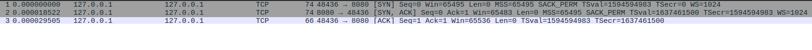
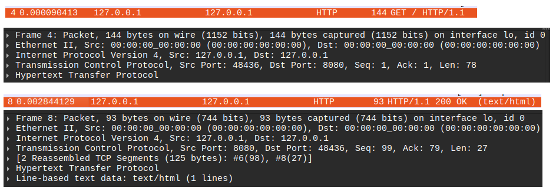
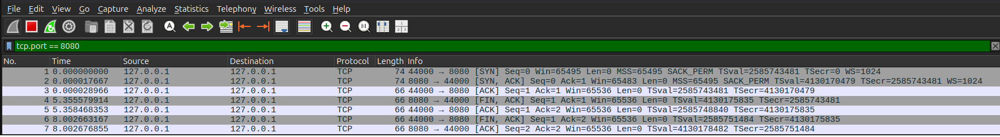
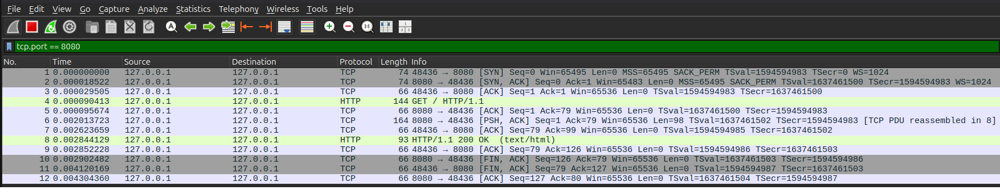

# Multithreaded HTTP Server

A simple multithreaded HTTP server written in C on Linux.

This project was built to practice TCP socket programming, POSIX threads, synchronization, and graceful shutdown.

## 1. Overview

The server listens on port `8080` and uses a **thread-per-client** model to handle multiple connections.

The main thread accepts connections and creates worker threads. Each worker receives an HTTP request, sends a response, and closes the connection.

**Environment**
- Language: C
- OS: Linux
- Libraries/APIs: POSIX sockets, pthread
- Build: GCC, Make
- Testing: curl, Wireshark, AddressSanitizer, ThreadSanitizer

## 2. Features

### TCP and Multithreading
- TCP server using `socket()`, `bind()`, `listen()`, and `accept()`
- One worker thread per client using `pthread_create()`
- Detached worker threads
- Mutex-protected active client counter
- Condition variable to wait for workers during shutdown

### HTTP Request and Response
- Receive and parse HTTP request headers
- Handle partial sends
- Limit request buffer size to 4096 bytes
- Set a 5-second receive timeout

| Status | Condition |
|---|---|
| 200 OK | `GET /` |
| 400 Bad Request | Request-line parsing failure |
| 404 Not Found | Unsupported path |
| 405 Method Not Allowed | Non-GET request to `/` |

### Shutdown and Logging
- Handle SIGINT and SIGTERM using `sigaction()`
- Block shutdown signals during worker creation
- Wait for active workers before exiting
- Log connections, requests, responses, and errors

## 3. Architecture

```text
                 TCP Clients
                      |
                      v
               Main Thread
              socket / bind
              listen / accept
                      |
               pthread_create()
                      |
          +-----------+-----------+
          |           |           |
          v           v           v
       Worker 1    Worker 2    Worker 3
          |           |           |
       recv()      recv()      recv()
       parse       parse       parse
       send()      send()      send()
       close()     close()     close()
          |           |           |
          +-----------+-----------+
                      |
              active_clients
              (Mutex Protected)
                      |
             pthread_cond_signal()
                      |
              Shutdown Wait
```

The main thread waits for `active_clients` to reach zero before completing shutdown.

## 4. Build and Usage

**Build**

```bash
make
```

**Run**

```bash
./http_server
```

**Test**

```bash
# 200 OK
curl -i http://127.0.0.1:8080/

# 404 Not Found
curl -i http://127.0.0.1:8080/unknown

# 405 Method Not Allowed
curl -i -X POST http://127.0.0.1:8080/
```

Stop the server with `Ctrl+C`.

```bash
make clean
```

## 5. Testing

### HTTP and Concurrency

- Tested HTTP 200, 400, 404, and 405 responses
- Tested multiple concurrent connections
- Verified that a slow client does not block other clients
- Tested receive timeout and graceful shutdown

### Compiler and Sanitizers

- GCC: `-Wall -Wextra -Werror`
- AddressSanitizer (ASan)
- ThreadSanitizer (TSan)

No sanitizer errors were reported in the executed tests.

### Wireshark

Captured TCP and HTTP traffic on the loopback interface.

**TCP Three-Way Handshake**



**HTTP Request and Response**



**TCP Connection Termination**


**Receive Timeout Scenario**



The packet capture alone does not confirm the cause of the connection closure.

**Complete HTTP Traffic**



## 6. Development Process

| Stage | Implementation |
|---|---|
| 1 | Sequential HTTP server |
| 2 | HTTP request parsing and status codes |
| 3 | Multithreaded server using pthread |
| 4 | Mutex, condition variable, graceful shutdown |
| 5 | Logging, concurrent tests, Wireshark |
| 6 | Final testing and documentation |

## 7. Limitations

- Supports only basic HTTP/1.1 requests
- Only `GET /` returns 200 OK
- No static file serving or persistent connections
- No thread pool or concurrent client limit
- Simplified HTTP request parsing
- No HTTPS support